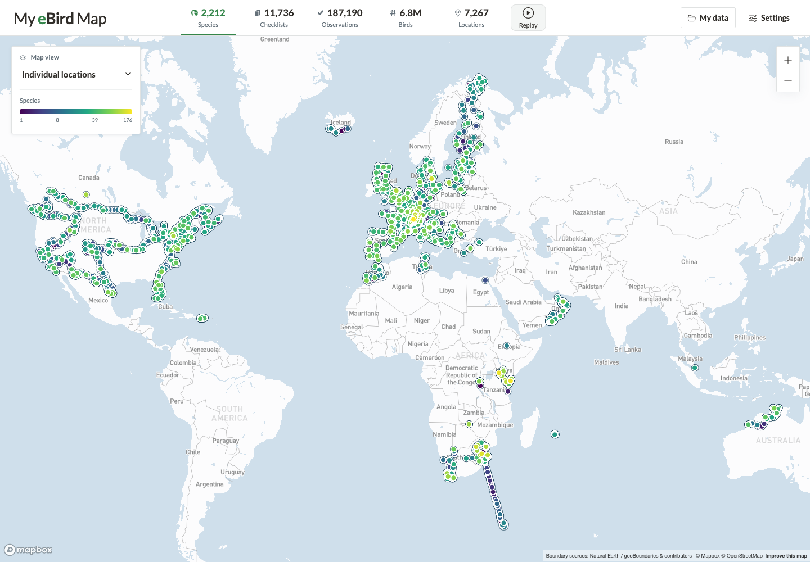
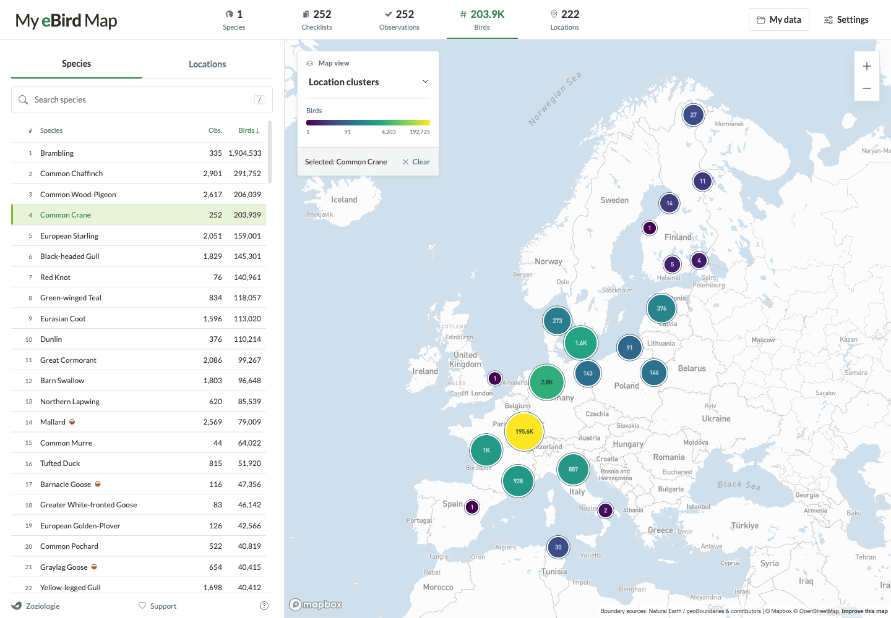
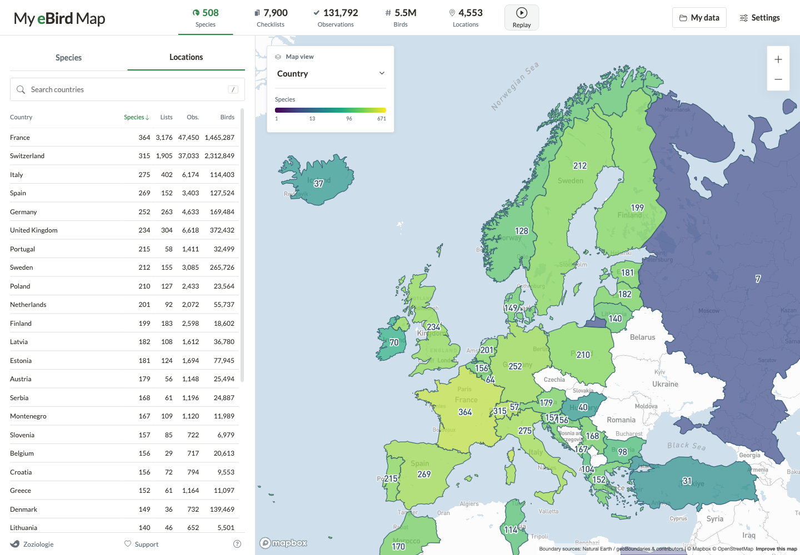

# My eBird Map

**Your eBird observations, mapped.** Explore the places you've been, the birds you've seen, and how your birding has grown over time.

[**Open My eBird Map**](https://zoziologie.raphaelnussbaumer.com/my-ebird-map/) · [Watch the replay](docs/media/region-replay.mp4) · [Report an issue](https://github.com/Zoziologie/my-ebird-map/issues)



## Explore your birding

- **See the big picture:** map individual locations, clusters, countries, regions, or a custom drawn area.
- **Follow your birds:** search and select species, filter by date, and explore locations and results.
- **Choose what to count:** compare species, checklists, observations, birds, or locations.
- **Replay your journey:** watch your checklists accumulate over time on the map.
- **Make it yours:** adjust the map and appearance; your view is remembered when you return.





## Get started

Open the app and try the demo, or download your data from eBird and import the CSV or ZIP through **My data**. Your import is saved in your browser; Google Drive backup and restore are optional.

My eBird Map is an independent project and is not affiliated with eBird. Counts can differ from eBird because of differences in taxonomy and exotic-status handling. See [regional exotic rules](docs/exotic-rules.md) for details.

## Built with

JavaScript and [Vite](https://vite.dev/), [Mapbox GL JS](https://www.mapbox.com/mapbox-gljs), [Papa Parse](https://www.papaparse.com/), [Supercluster](https://github.com/mapbox/supercluster), and IndexedDB. The app uses the eBird taxonomy and bundled country and regional boundaries. Tests use Node.js and Playwright.

## Run locally

Requires Node.js 22.13 or newer and a Mapbox access token.

```sh
npm ci
cp .env.example .env
# Set VITE_MAPBOX_ACCESS_TOKEN in .env.
npm run dev
```

Open <http://localhost:5173/my-ebird-map/>. To enable optional backups, also set `VITE_GOOGLE_CLIENT_ID`; see [Google Drive setup](docs/google-drive-setup.md).

```sh
npm run lint
npm test
npm run build
```

For browser tests and additional checks, see [testing](docs/testing.md). For deployment, see [deployment](docs/deployment.md). Learn more about [country boundaries](docs/country-polygons.md), [region boundaries](docs/region-polygons.md), and [release notes](docs/releases/README.md).
